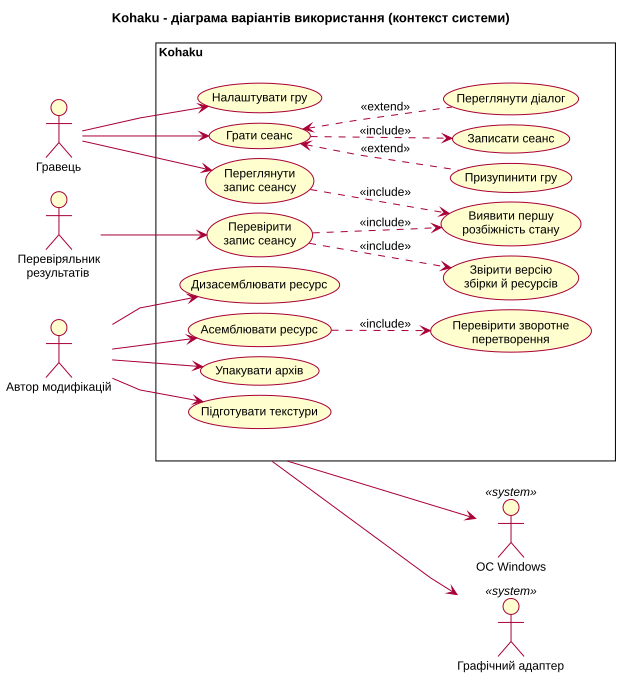
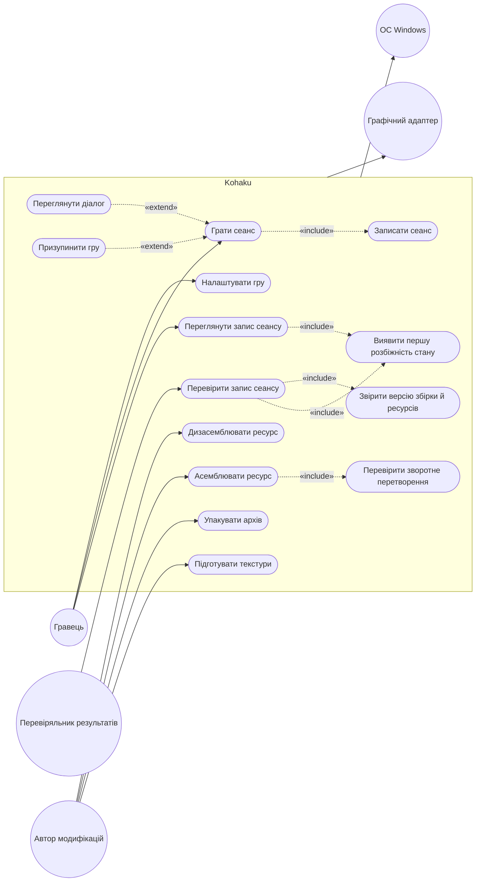
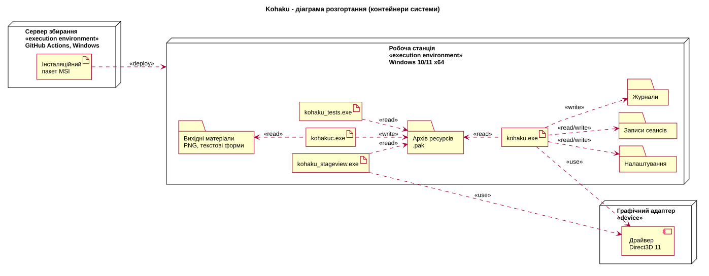
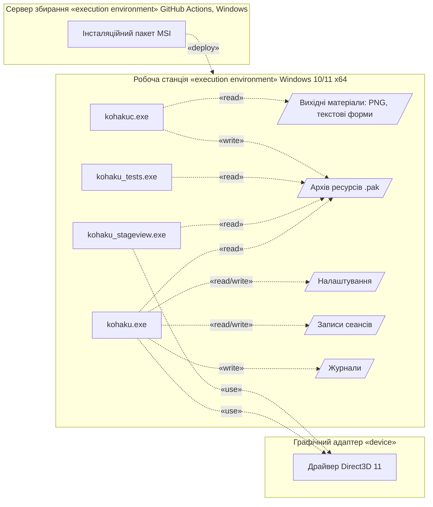
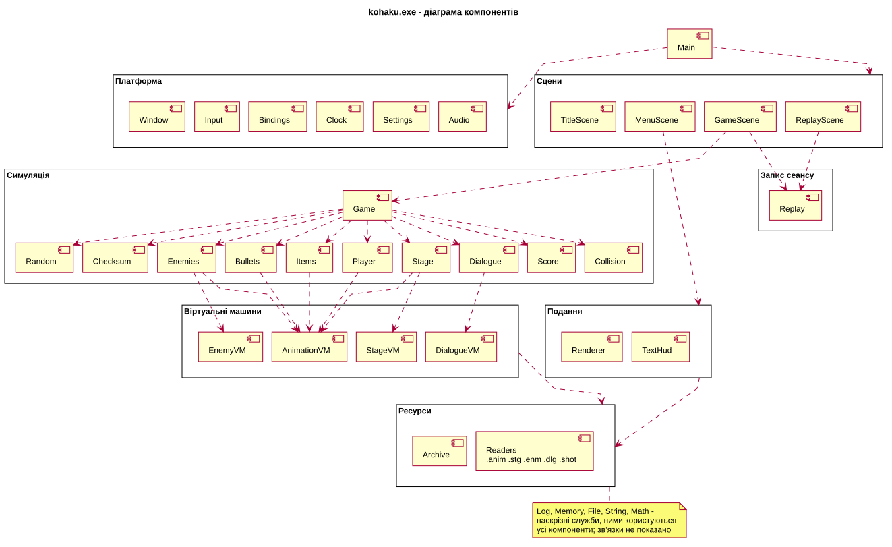
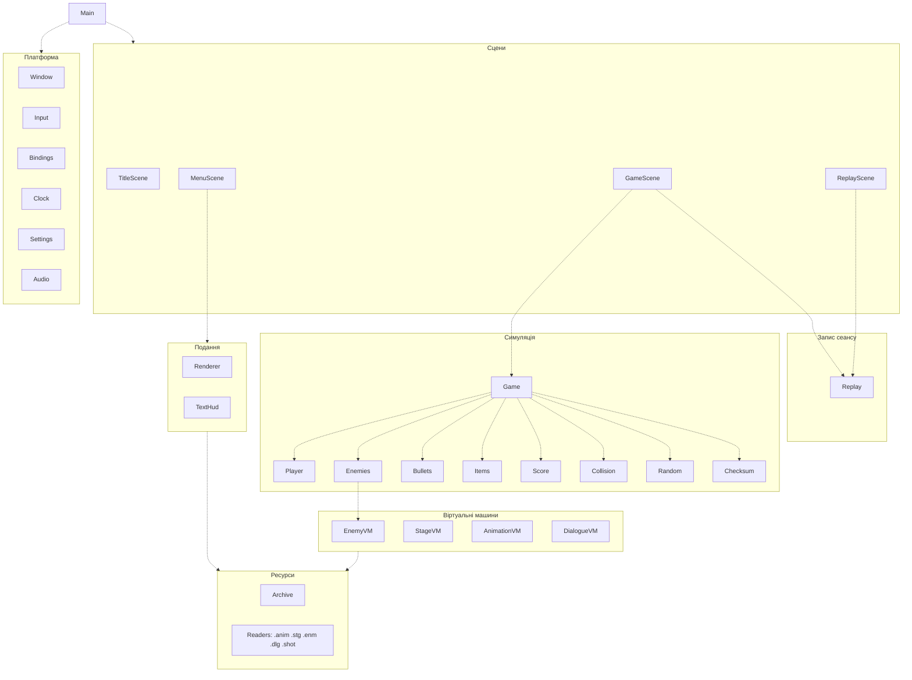

# РОЗДІЛ 2. ПРОЄКТУВАННЯ АРХІТЕКТУРИ СИСТЕМИ

Розділ описує архітектуру цільової системи Kohaku за моделлю C4 у нотації UML: рівень контексту – діаграмою варіантів використання, рівень контейнерів – діаграмою розгортання, рівень компонентів – діаграмою компонентів. Діаграми задано кодом (Diagrams-as-Code): джерела PlantUML лежать у каталозі [diagrams/](diagrams/), а під кожною діаграмою наведено той самий зміст кодом Mermaid. Кожен елемент архітектури посилається на вимоги специфікації [srs.md](srs.md), які він реалізує.

## 2.1. Контекстне та контейнерне моделювання системи (C4 Model)

### Рівень 1: контекст системи

Джерело: [level1-use-cases.puml](diagrams/level1-use-cases.puml).

Код Mermaid

Межа системи охоплює чотирнадцять варіантів використання трьох ініціаторів. Усі три – зовнішні користувачі готового продукту; розробники рушія й служба автоматичного збирання продукт створюють, а не використовують, тому на діаграмі їх немає ([SRS-NFR-QUAL-03](srs.md#srs-nfr-qual-03)). Гравець налаштовує гру ([SRS-FUN-07](srs.md#srs-fun-07)), грає сеанс і переглядає записи. Сеанс завжди записується (`«include»`, [SRS-FUN-16](srs.md#srs-fun-16)), а пауза ([SRS-FUN-15](srs.md#srs-fun-15)) і діалог ([SRS-FUN-28](srs.md#srs-fun-28)) розширюють його за умовою (`«extend»`). Перегляд запису включає виявлення першої розбіжності стану ([SRS-FUN-17](srs.md#srs-fun-17)). Перевіряльник результатів перевіряє запис, отриманий від іншого гравця, без вікна ([SRS-FUN-48](srs.md#srs-fun-48)): перевірка включає звіряння версії збірки й ресурсів ([SRS-FUN-49](srs.md#srs-fun-49)) і те саме виявлення першої розбіжності. Автор модифікацій дизасемблює й асемблює ресурси, пакує архів і готує текстури ([SRS-FUN-42](srs.md#srs-fun-42) – [SRS-FUN-47](srs.md#srs-fun-47)); асемблювання включає перевірку зворотного перетворення ([SRS-FUN-46](srs.md#srs-fun-46)). Зовнішні системи, від яких залежить уся система, – ОС Windows і графічний адаптер; мережевих систем на діаграмі немає ([SRS-NFR-SEC-01](srs.md#srs-nfr-sec-01)).

### Рівень 2: контейнери системи

Джерело: [level2-deployment.puml](diagrams/level2-deployment.puml).

Код Mermaid

Контейнер у цій системі – виконуваний файл або сховище файлів на робочій станції. Мережевих служб і контейнеризації продукт не має, тому розгортання – це встановлення файлів з інсталяційного пакета MSI, який створює сервер збирання ([SRS-NFR-DEL-01](srs.md#srs-nfr-del-01)).

- **kohaku.exe** – рушій і демонстраційна гра в одному процесі. Читає архів ресурсів ([SRS-FUN-35](srs.md#srs-fun-35)), читає й пише налаштування ([SRS-FUN-07](srs.md#srs-fun-07)) і записи сеансів ([SRS-FUN-18](srs.md#srs-fun-18)), пише журнал і малює через драйвер Direct3D 11 ([SRS-FUN-37](srs.md#srs-fun-37), [SRS-FUN-38](srs.md#srs-fun-38)). Модель арифметики симуляції закріплено рішенням [ADR-001](adr/0001-choice-of-technology.md).
- **kohakuc.exe** – інструментарій. Читає вихідні матеріали (зображення PNG і текстові форми ресурсів), пише архів ресурсів ([SRS-FUN-42](srs.md#srs-fun-42) – [SRS-FUN-47](srs.md#srs-fun-47)). Від рушія його відділяє формат файлу: контракт між контейнерами – формат ресурсу, а не виклик функції.
- **kohaku_stageview.exe** – засіб звіряння: малює сцену й записує покадровий дамп стану камери для порівняння з еталоном.
- **kohaku_tests.exe** – модульні тести; читає еталонний корпус ресурсів (розділ 4 специфікації).
- **Архів ресурсів, вихідні матеріали, налаштування, записи сеансів, журнали** – сховища файлів. СКБД система не застосовує: усі дані мають вигляд послідовних потоків, які читають від початку до кінця.

Кожна залежність має стереотип UML: `«read»`, `«write»`, `«read/write»` для доступу до файлів, `«use»` для виклику драйвера через Direct3D 11 і DXGI, `«deploy»` для встановлення пакета.

## 2.2. Компонентне моделювання критичного сервісу системи

Для декомпозиції обрано контейнер kohaku.exe: у ньому зосереджено обчислювальне навантаження (крок симуляції з тисячами об’єктів) і всі механізми детермінізму.

Джерело: [level3-components.puml](diagrams/level3-components.puml).

Код Mermaid

Компоненти згруповано в сім пакетів; залежності спрямовані лише вниз, циклів немає.

- **Main** – корінь композиції платформи. Будує ланцюг модулів на стеку, виконує цикл кадру й переходи між сценами, руйнує модулі у зворотному порядку. Логіки гри не містить.
- **Платформа** – вхідний шар: Window (вікно, режими, DPI – [SRS-FUN-01](srs.md#srs-fun-01) – [SRS-FUN-03](srs.md#srs-fun-03)), Input і Bindings (клавіатура → маска дій – [SRS-FUN-04](srs.md#srs-fun-04), [SRS-FUN-05](srs.md#srs-fun-05)), Clock (фіксований крок – [SRS-FUN-09](srs.md#srs-fun-09), [SRS-FUN-10](srs.md#srs-fun-10)), Settings ([SRS-FUN-07](srs.md#srs-fun-07)), Audio ([SRS-FUN-08](srs.md#srs-fun-08)).
- **Сцени** – єдина поліморфна роль системи: TitleScene, MenuScene, GameScene, ReplayScene ([SRS-FUN-41](srs.md#srs-fun-41)). Сцена повертає запит на перехід, виконує його Main; жодна сцена не створює іншої. Пауза – стан усередині GameScene ([SRS-FUN-15](srs.md#srs-fun-15)). Через пакет «Подання» малюють усі сцени; на діаграмі цю залежність показано однією стрілкою.
- **Симуляція** – межа детермінізму ([SRS-NFR-DET-05](srs.md#srs-nfr-det-05)). Game – корінь композиції симуляції: володіє станом світу й записує порядок кроку в коді одного методу ([SRS-FUN-11](srs.md#srs-fun-11)). Player, Enemies, Bullets, Items і Score володіють власними записами в пулах і власним кроком і не знають одне про одного ([SRS-FUN-19](srs.md#srs-fun-19) – [SRS-FUN-27](srs.md#srs-fun-27)). Collision – вільні функції, що отримують обидві сторони взаємодії як аргументи ([SRS-FUN-25](srs.md#srs-fun-25)). Random і Checksum – генератор PCG32 у складі стану й контрольна сума FNV-1a ([SRS-FUN-13](srs.md#srs-fun-13), [SRS-FUN-14](srs.md#srs-fun-14)).
- **Запис сеансу** – Replay зберігає маски дій і контрольні суми кроків і ніколи не змінює стан світу ([SRS-FUN-16](srs.md#srs-fun-16) – [SRS-FUN-18](srs.md#srs-fun-18)).
- **Віртуальні машини** – виконавці сценаріїв ресурсів: EnemyVM (поведінка ворогів, фази атаки, складність – [SRS-FUN-29](srs.md#srs-fun-29), [SRS-FUN-23](srs.md#srs-fun-23), [SRS-FUN-24](srs.md#srs-fun-24)), StageVM ([SRS-FUN-31](srs.md#srs-fun-31)), AnimationVM ([SRS-FUN-30](srs.md#srs-fun-30)), DialogueVM ([SRS-FUN-32](srs.md#srs-fun-32)).
- **Подання** – Renderer (пакетування спрайтів, класи текстур, ціль сцени й компонування інтерфейсу – [SRS-FUN-36](srs.md#srs-fun-36) – [SRS-FUN-39](srs.md#srs-fun-39)) і TextHud (текст спрайтами з банку гліфів – [SRS-FUN-40](srs.md#srs-fun-40)).
- **Ресурси** – Archive і читачі форматів .anim, .stg, .enm, .dlg, .shot ([SRS-FUN-33](srs.md#srs-fun-33) – [SRS-FUN-35](srs.md#srs-fun-35)). Читачі перевіряють файл на межі: обрізаний файл або файл із невідповідною контрольною сумою вмісту відхиляється ([SRS-NFR-INT-01](srs.md#srs-nfr-int-01)).

Наскрізні служби Log, Memory, File, String і Math використовують усі компоненти, тому на діаграмі їх винесено в примітку.

Правила, які задає ця декомпозиція:

1. Модуль володіє своїми записами й своїм кроком і не знає інших модулів. Bullets не знає, що існує гравець, тож його тестують окремо.
2. Взаємодія двох модулів не належить жодному з них: влучання кулі в гравця – вільна функція з обома сторонами в аргументах.
3. Залежності передаються аргументами, шини подій немає. Коли один прохід створює те, що потрібно кільком модулям (вороги, знищені на кроці), він пише типізований список, і Game передає його кожному споживачеві явно.
4. Порядок кроку – код, а не пріоритети: перестановка двох рядків у Game – зміна, яку видно в будь-якому порівнянні версій.
5. Межу детермінізму забезпечують типи: Game не бачить Input, Clock, Renderer і файлів; малювання – константний метод, тож компілятор забороняє йому змінювати стан. Тести збирають симуляцію без бібліотеки візуалізації, і компоновщик перевіряє правило на кожному збиранні.
6. Пам’ять виділяється на початку сцени й ніколи протягом кроку ([SRS-NFR-MEM-01](srs.md#srs-nfr-mem-01)).

Обробка помилок і валідація: кожна операція, що може не вдатися, повертає код RESULT, а корінь композиції записує причину в журнал рівня FAILURE і завершує процес ненульовим кодом ([SRS-NFR-REL-03](srs.md#srs-nfr-rel-03)); вхідні дані перевіряються на межі – CommandLine відхиляє невідомий параметр ([SRS-FUN-06](srs.md#srs-fun-06)), читачі ресурсів відхиляють пошкоджені файли. Компонентів автентифікації й авторизації схема не містить: система не має облікових записів, мережевого інтерфейсу й персональних даних ([SRS-NFR-SEC-01](srs.md#srs-nfr-sec-01)).

## 2.3. Документування архітектурних рішень (Architecture Decision Records)

Ключове рішення – модель арифметики симуляції – зафіксовано в [ADR-001](adr/0001-choice-of-technology.md). Повний текст наведено нижче.

### ADR-001: Модель арифметики симуляції – IEEE 754 f32 із закріпленим компілятором і CRT

**Статус:** Approved (затверджено), 18.10.2026.

**Контекст.** Вимога [SRS-NFR-DET-01](srs.md#srs-nfr-det-01) вимагає побітового збігу стану між конфігураціями збирання, [SRS-NFR-DET-02](srs.md#srs-nfr-det-02) – між машинами, а [SRS-NFR-PERF-01](srs.md#srs-nfr-perf-01) обмежує тривалість кроку 2 мс на 99-му перцентилі при 5 000 об’єктів. Результат операцій з рухомою комою залежить від трьох чинників: дозволу компілятора переставляти й скорочувати вирази, реалізації математичних функцій CRT і набору інструкцій процесора. Рішення має закріпити всі три або обійти рухому кому взагалі.

**Альтернативи.**

1. Fixed point (цілі числа зі зсувом, як Q48.16 у Photon Quantum). Цілочисельна арифметика однакова на будь-якому процесорі й з будь-яким компілятором. Ціна – власна реалізація тригонометрії й квадратного кореня, обмежений діапазон (Photon Quantum радить тримати значення в межах Int16 через неперевірене переповнення швидкого множення), перетворення чисел перед передаванням у шейдер і перехід усього математичного модуля на новий тип.
2. f32 з /fp:fast. Найшвидший варіант, проте компілятор має право переставляти операції й генерувати FMA, тож результат змінюється від збирання до збирання. Вимогу SRS-NFR-DET-01 порушує за визначенням.
3. f32 з /fp:strict. Детермінований, проте за документацією MSVC дорожчий за /fp:precise: компілятор вставляє інструкції для доступу до середовища рухомої коми, яким рушій не користується.
4. f64 з /fp:precise. Подвоює обсяг даних об’єктів і навантаження на пам’ять; до того ж функції CRT для double на x64 мають шлях FMA3, результат якого відрізнявся від звичайного в 0,96 % випадків для sin на мільйоні вхідних значень.
5. f32 з /fp:precise і статично зв’язаним CRT (обране).

**Рішення.** Арифметика симуляції – IEEE 754 f32. Компілятор MSVC працює з ключем /fp:precise: він не переставляє й не скорочує вирази, а з Visual Studio 2022 не генерує контракцій FMA без окремого ключа /fp:contract. CRT зв’язано статично (/MT), тож математичні функції входять до виконуваного файлу й не змінюються оновленням Windows. Модуль Math обгортає лише функції f32; вимірювання на мільйоні вхідних значень не виявило жодної розбіжності між шляхом FMA3 і звичайним для sinf, cosf, atan2f і powf. Якщо до модуля колись додадуть функцію double, у тій самій зміні треба вимкнути FMA3 викликом _set_FMA3_enable.

**Наслідки.**

Позитивні:
- арифметика апаратна: f32 обробляється інструкціями SSE без програмної емуляції тригонометрії й кореня; чи достатньо цього для SRS-NFR-PERF-01, покаже вимірювання;
- той самий тип чисел використовують шейдери HLSL, тож дані об’єктів передаються у візуалізацію без перетворення;
- детермінізм між Debug і Release підтверджено вимірюванням (SRS-NFR-DET-01).

Негативні й ризики:
- детермінізм гарантовано лише для того самого виконуваного файлу; збірка іншим компілятором або іншою версією MSVC може дати інший результат, тож записи сеансів прив’язані до збірки;
- гарантія між машинами спирається на однакову архітектуру x64 і на відсутність у коді симуляції функцій double; вимогу SRS-NFR-DET-02 ще не перевірено на другій машині;
- дисципліна коду стає частиною архітектури: ключ /fp:fast чи /fp:contract у CMakeLists.txt або функція double без _set_FMA3_enable тихо зламає детермінізм, тож ці ключі треба контролювати в CI;
- статичний CRT збільшує розмір кожного виконуваного файлу й переносить оновлення безпеки CRT на перезбирання проєкту;
- оновлення набору інструментів MSVC навіть у межах Visual Studio 2022 може змінити згенерований код або версію CRT, тож версію набору інструментів треба фіксувати в CI, а після її зміни – повторно відтворювати еталонні записи;
- рішення прив’язує проєкт до MSVC і Windows (vendor lock-in): перенесення на інший компілятор вимагає повторної перевірки детермінізму, і записи сеансів між збірками різних компіляторів несумісні.
