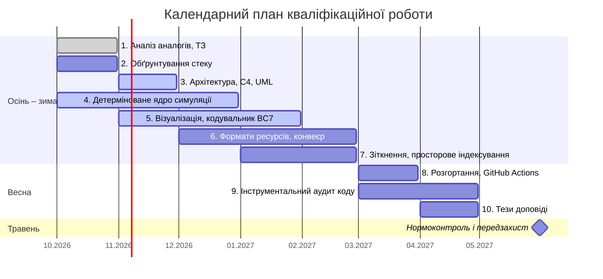

# Пояснювальна записка

Тема: «Розробка детермінованого ігрового рушія для двовимірних відеоігор реального часу».

Кваліфікаційна робота бакалавра, спеціальність F2 «Інженерія програмного забезпечення», кафедра програмного забезпечення комп’ютерних систем, Чернівецький національний університет імені Юрія Федьковича.

## Структура документації

| Файл | Розділ записки | Зміст | Стан |
| ---- | -------------- | ----- | ---- |
| [proposal.md](proposal.md) | – | Технічна картка ідеї | Готово |
| [0_intro.md](0_intro.md) | Вступ | Актуальність, об’єкт, предмет, мета, завдання | Готово |
| [1_analysis.md](1_analysis.md) | Розділ 1 | Огляд підходів, аналіз аналогів, модель As-Is, модель To-Be, вимоги, постановка задачі | Готово |
| [srs.md](srs.md) | – | Специфікація вимог цільової системи за ISO/IEC/IEEE 29148: 49 функціональних і 20 нефункціональних вимог, критерії верифікації, глосарій | Готово |
| [2_design.md](2_design.md) | Розділ 2 | Модель C4 в нотації UML: варіанти використання, розгортання, компоненти; трасування вимог; ADR | В роботі: підрозділи 2.1–2.3 |
| [diagrams/](diagrams/) | Розділ 2 | Джерела діаграм PlantUML і зображення SVG | Готово |
| [adr/](adr/) | Розділ 2 | Записи архітектурних рішень: [ADR-001](adr/0001-choice-of-technology.md) – модель арифметики симуляції | Approved |
| [3_implementation.md](3_implementation.md) | Розділ 3 | Інтерфейс, тестування, розгортання | Не розпочато |
| [4_conclusions.md](4_conclusions.md) | Висновки | Загальні висновки | Не розпочато |

Робочий простір знань: [`F2_Diploma_Repetovskyi_V/`](../F2_Diploma_Repetovskyi_V/) (сховище Obsidian).

## Розділ 1: зведений документ

Зведений документ розділу 1 [F2_Diploma_Chapter1_Repetovskyi](https://docs.google.com/document/d/1Hs8xTehzv7IyY-_yGKcfHyNquhNRw8J5/edit) (Google Docs, доступ «Can comment» для викладача й наукового керівника).

## Нефункціональні вимоги

Повна матриця зі способами перевірки – у [підрозділі 1.5.3](1_analysis.md#153-нефункціональні-вимоги-nfrs).

| Категорія | Метрика й поріг | Стан |
| --------- | --------------- | ---- |
| Продуктивність | Крок симуляції: p99 ≤ 2,0 мс при 5 000 активних об’єктів | Ціль |
| Продуктивність | Рівно 60 кроків за секунду при дисплеї 60, 144 і 240 Гц | 60 Гц підтверджено |
| Продуктивність | Виклики Draw = зміни текстури чи змішування + ⌈N/4096⌉ (5 000 спрайтів одного атласу – 2) | За кодом підтверджено |
| Пам’ять | 0 виділень купи протягом кроку | Підтверджено тестом |
| Пам’ять | 0 витоків на завершенні | Ціль |
| Детермінізм | Збіг контрольних сум кроків між Debug і Release; між двома машинами | Debug/Release підтверджено |
| Детермінізм | Розбіжність локалізується з точністю до 1 кроку | Підтверджено тестом |
| Розмір запису | 4 байти введення на крок, 864 000 байтів на годину | Підтверджено |
| Надійність | Не більше 4 кроків надолуження після зупинки | Підтверджено тестом |
| Цілісність і якість | Пошкоджений ресурс відхиляється; 0 попереджень при `/W4 /WX` | Підтверджено |
| Безпека | Мережевого доступу й персональних даних немає: OAuth 2.0, JWT і GDPR не застосовні | Підтверджено `dumpbin /imports` |

## Календарний план

| № з/п | Назва етапу кваліфікаційної роботи | Термін виконання етапів проєкту | Примітка / Статус виконання |
| ----- | ---------------------------------- | ------------------------------- | --------------------------- |
| 1 | Аналіз рушіїв-аналогів і формування технічного завдання | Жовтень 2026 | Done |
| 2 | Обґрунтування технологічного стеку та ключів компілятора | Жовтень 2026 | To Do |
| 3 | Проєктування багатошарової архітектури рушія (модель C4, діаграми UML) | Листопад 2026 | In Progress |
| 4 | Реалізація детермінованого ядра симуляції: фіксований крок, генератор псевдовипадкових чисел, згортання стану в контрольну суму, запис сеансу | Жовтень – Грудень 2026 | In Progress |
| 5 | Реалізація підсистеми візуалізації та кодувальника текстур BC7 | Листопад 2026 – Січень 2027 | In Progress |
| 6 | Розроблення бінарних форматів ресурсів і конвеєра їх підготовки (асемблер, дизасемблер) | Грудень 2026 – Лютий 2027 | To Do |
| 7 | Розроблення обробки зіткнень і вимірювання виграшу просторового індексування | Січень – Лютий 2027 | To Do |
| 8 | Схема розгортання: автоматизоване складання на GitHub Actions, інсталяційний пакет | Березень 2027 | To Do |
| 9 | Інструментальний аудит коду: модульне тестування, регресійне звіряння записів сеансів, контроль тривалості кроку | Березень – Квітень 2027 | To Do |
| 10 | Апробація результатів: тези доповіді на студентській науковій конференції | Квітень 2027 | To Do |

Травень 2027 року відведено під нормоконтроль і передзахист.

