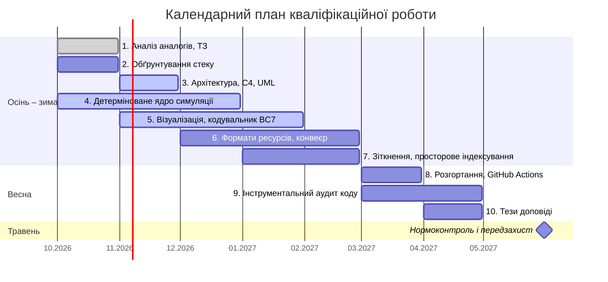

Структура повторює Лист завдання (Додаток Б методичних вказівок). Етапи виведено із завдань на сторінці [[Науковий апарат проєкту]]; хід планування – в [[AI Insights]], розділ «Е2 · Завдання 2». Етапи 1–7 завершуються не пізніше лютого 2027 року, етапи 8–10 – не пізніше кінця квітня; травень лишено під нормоконтроль і передзахист.

| № з/п | Назва етапу кваліфікаційної роботи | Термін виконання етапів проєкту | Примітка / Статус виконання |
| ----- | ---------------------------------- | ------------------------------- | --------------------------- |
| 1     | Аналіз рушіїв-аналогів і формування технічного завдання | Жовтень 2026 | Done |
| 2     | Обґрунтування технологічного стеку та ключів компілятора | Жовтень 2026 | To Do |
| 3     | Проєктування багатошарової архітектури рушія (модель C4, діаграми UML) | Листопад 2026 | In Progress |
| 4     | Реалізація детермінованого ядра симуляції: фіксований крок, генератор псевдовипадкових чисел, згортання стану в контрольну суму, запис сеансу | Жовтень – Грудень 2026 | In Progress |
| 5     | Реалізація підсистеми візуалізації та кодувальника текстур BC7 | Листопад 2026 – Січень 2027 | In Progress |
| 6     | Розроблення бінарних форматів ресурсів і конвеєра їх підготовки (асемблер, дизасемблер) | Грудень 2026 – Лютий 2027 | To Do |
| 7     | Розроблення обробки зіткнень і вимірювання виграшу просторового індексування | Січень – Лютий 2027 | To Do |
| 8     | Схема розгортання: автоматизоване складання на GitHub Actions, інсталяційний пакет | Березень 2027 | To Do |
| 9     | Інструментальний аудит коду: модульне тестування, регресійне звіряння записів сеансів, контроль тривалості кроку | Березень – Квітень 2027 | To Do |
| 10    | Апробація результатів: тези доповіді на студентській науковій конференції | Квітень 2027 | To Do |

Значення графи «Примітка / Статус виконання»: To Do, In Progress, Done.

## Roadmap

